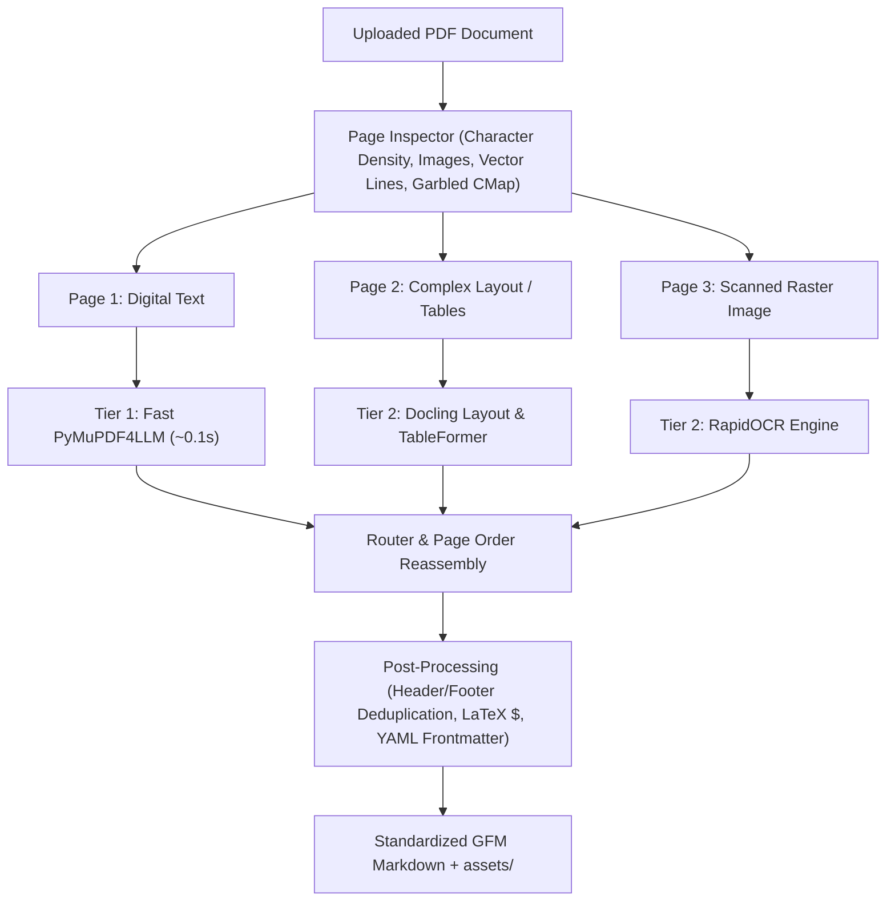

# OmniPDF2MD

> **Local-First, Universal PDF-to-Markdown Converter Studio with Smart Per-Page Routing, OCR Fallback & Vietnamese Typography Fidelity.**

[](https://www.python.org/)
[](https://opensource.org/licenses/MIT)
[](https://github.com/astral-sh/ruff)
[](https://mypy-lang.org/)

---

## 📖 Table of Contents
1. [Core Features](#-core-features)
2. [Architecture & Per-Page Routing](#-architecture--per-page-routing)
3. [Multi-Tier Conversion Engines](#-multi-tier-conversion-engines)
4. [Quick Start (One-Touch Setup)](#-quick-start)
5. [CLI Reference](#-cli-reference)
6. [Local Web Studio UI](#-local-web-studio-ui)
7. [Hardware Acceleration (NVIDIA CUDA)](#-hardware-acceleration-nvidia-cuda)
8. [Local VLM Setup (Ollama)](#-local-vlm-setup-ollama)
9. [Vietnamese Unicode & Typography Fidelity](#-vietnamese-unicode--typography-fidelity)
10. [Testing & Quality Verification](#-testing--quality-verification)

---

## ✨ Core Features

- **100% Offline & Private:** Zero cloud dependencies, zero external telemetry. All conversions, layout analyses, OCR, and VLM operations execute locally on your machine.
- **Smart Per-Page Routing:** Never applies a blunt document-wide conversion. Analyzes each page individually using vector heuristics to select the fastest, highest-fidelity engine.
- **Multi-Tier Conversion Pipeline:**
  - **Tier 1 (Fast PyMuPDF):** Instant conversion for clean digital text (~0.1s/page).
  - **Tier 2 (Deep Docling + RapidOCR):** Deep multi-column layout analysis, borderless table reconstruction, and OCR for scanned pages.
  - **Tier 3 (Local VLM Fallback):** Multimodal visual LLM transcription via local Ollama (`qwen2.5vl` / `llama3.2-vision`) for heavily distorted or stylized pages.
- **Anti-OOM & Memory Safety:** Page batching (default 15 pages per batch), deterministic reference releasing, and garbage collection safeguards prevent out-of-memory crashes on 100+ page documents.
- **Sequential Background Queue:** FastAPI + SQLite WAL background worker processes jobs sequentially, preventing multiple heavy OCR models from competing for RAM/VRAM.
- **SHA-256 Hash Caching:** Instantaneous cache hits for previously converted documents with identical options.
- **Real-Time SSE Streaming:** Page-by-page progress notifications streamed to the Web Studio in real time.
- **Bilingual & Vietnamese Typography Fidelity:** TrueType Unicode font embedding and garbled CMap detection preserve Vietnamese diacritics without broken glyphs.

---

## 🏛 Architecture & Per-Page Routing



---

## ⚙ Multi-Tier Conversion Engines

| Tier | Engine | Ideal For | Speed | Dependencies |
| :--- | :--- | :--- | :--- | :--- |
| **Tier 1** | `fast_pymupdf` | Digital PDFs with clean embedded text, single/double column | ~0.1s / page | `pymupdf`, `pymupdf4llm` |
| **Tier 2** | `deep_docling` | Complex layouts, borderless tables, multi-column articles, and scanned pages | ~1.5s - 4.0s / page | `docling`, `rapidocr`, `torch` |
| **Tier 3** | `vlm_ollama` | Distorted scans, handwritten notes, complex mathematical typography | ~3.0s - 8.0s / page | Local `ollama` instance |

---

## 🚀 Quick Start

### Windows 11 (PowerShell)
Clone the repository and run the automated bootstrap script:
```powershell
git clone https://github.com/Minha-make/pdf_to_md.git
cd pdf_to_md
.\setup.ps1
```

To launch the Web Studio:
```powershell
.\.venv\Scripts\omnipdf serve
```

### Linux / macOS (Bash)
```bash
git clone https://github.com/Minha-make/pdf_to_md.git
cd pdf_to_md
chmod +x setup.sh
./setup.sh
```

To launch the Web Studio:
```bash
source .venv/bin/activate
omnipdf serve
```

---

## 💻 CLI Reference

OmniPDF2MD includes a Typer CLI:

### 1. Start the Local Web Studio Server
```bash
omnipdf serve --port 8765 --open
```
- `--host` / `-h`: Interface to bind (default: `127.0.0.1`).
- `--port` / `-p`: Port to listen on (default: `8765`).
- `--open` / `--no-open`: Automatically open default web browser (default: `True`).
- `--reload`: Enable auto-reload for development.

### 2. Convert PDF Directly from Terminal
```bash
omnipdf convert document.pdf -o output_dir --mode auto
```
- `--mode` / `-m`: Conversion mode (`auto` [default], `fast`, `deep`).
- `-o`, `--output`: Output directory for Markdown and assets (default: `output/`).
- `-p`, `--password`: Password for AES-encrypted PDFs.
- `--images` / `--no-images`: Extract embedded images into `assets/` (default: `True`).
- `--frontmatter` / `--no-frontmatter`: Include YAML metadata header (default: `True`).

### 3. Check System Health & Dependencies
```bash
omnipdf doctor
```
Verifies Python version, PyMuPDF, TrueType Unicode fonts, NVIDIA CUDA acceleration, and Ollama connection status.

---

## 🖥 Local Web Studio UI

The Web Studio is built with **React 18 + TypeScript + Vite + TailwindCSS** and served natively from FastAPI:

1. **Header & Hardware Monitor:** Displays active compute device (`CUDA GPU` or `CPU`), Ollama VLM connection, and pending queue depth.
2. **Sidebar & Upload Dropzone:** Drag-and-drop single or multiple PDFs, select conversion mode (`Auto`, `Fast`, `Deep`), configure password protection, and monitor live progress bars.
3. **Split-Pane Synchronized Inspector:**
   - **Left Pane:** High-resolution PDF canvas powered by `pdfjs-dist` with page navigation and zoom controls.
   - **Right Pane:** Switch between **Rendered Markdown** (with GitHub Flavored Markdown, KaTeX math formulas, and inline extracted images) and **Raw Markdown Editor** with word/line counters.
4. **Export Toolbar:** One-click copy to clipboard, direct `.md` download, and bundled `.zip` archive download containing all extracted image assets.

---

## ⚡ Hardware Acceleration (NVIDIA CUDA)

OmniPDF2MD runs out of the box on CPU. To accelerate Docling layout models and OCR via an NVIDIA GPU:

```powershell
# Windows
.\.venv\Scripts\pip install torch torchvision --index-url https://download.pytorch.org/whl/cu124
```

Verify GPU activation with:
```powershell
.\.venv\Scripts\omnipdf doctor
```

---

## 🦙 Local VLM Setup (Ollama)

To enable Tier 3 local VLM fallback for challenging scanned pages:

1. Download and install [Ollama](https://ollama.ai/).
2. Pull the visual language model:
   ```bash
   ollama run qwen2.5-vl:7b
   ```
3. Set your environment variable in `.env` if using a custom Ollama host:
   ```env
   OMNIPDF_OLLAMA_BASE_URL="http://127.0.0.1:11434"
   OMNIPDF_OLLAMA_MODEL="qwen2.5-vl:7b"
   ```

---

## 🇻🇳 Vietnamese Unicode & Typography Fidelity

Vietnamese text extraction commonly suffers from broken diacritics (e.g. `ti\xea\u0301ng Vi\u0323\xea\u0302t`) and corrupted non-breaking spaces. OmniPDF2MD implements:
- **NFKC Unicode Normalization:** Unifies precomposed and decomposed Unicode forms while retaining accurate tone marks.
- **Garbled CMap Guard:** Detects replacement characters (`\ufffd`) and broken diacritic sequences, automatically routing affected pages to OCR/VLM.
- **TrueType TTF Embedding:** Test fixtures embed Arial/Segoe UI TrueType fonts to ensure faithful cross-platform font rendering.

---

## 🧪 Testing & Quality Verification

Run the complete test suite:
```powershell
# Full test suite
.\.venv\Scripts\pytest -v

# Strict Ruff linting
.\.venv\Scripts\ruff check .

# Strict Mypy type verification
.\.venv\Scripts\mypy src tests
```

---

## 📄 License
This project is licensed under the [MIT License](LICENSE).
